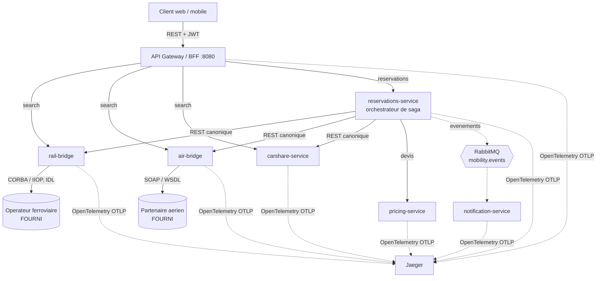
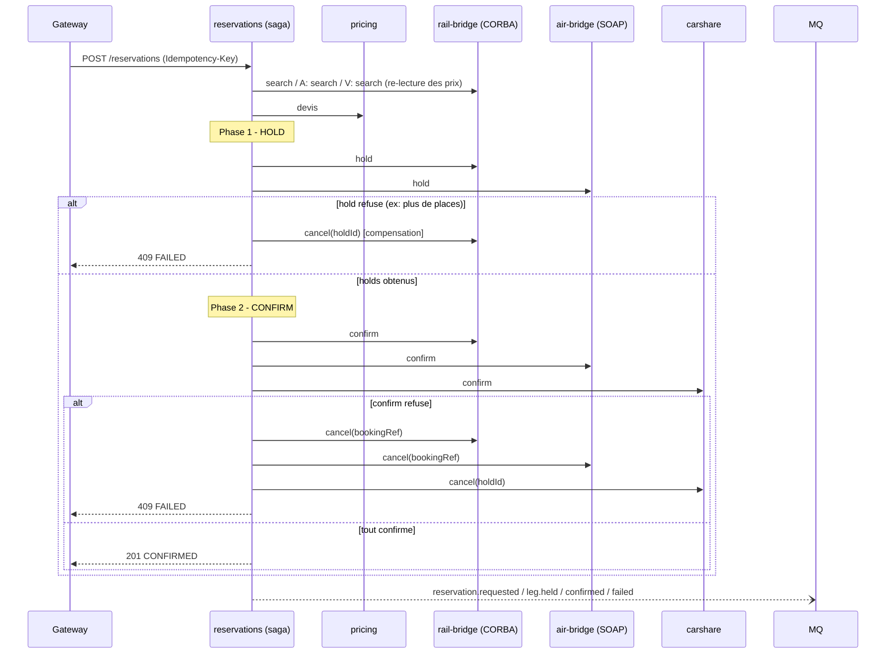

# 05 — Architecture, saga et décisions (ADR)

Base du **dossier d'architecture** et du rapport. Les diagrammes sont en Mermaid
(rendus par GitHub, IntelliJ, mermaid.live).

## 1. Vue d'ensemble

Chaque microservice (carshare, pricing, reservations, notification) a **sa propre base H2**.

## 2. Saga de réservation (orchestration)

## 3. Décisions (ADR courts, à développer dans le rapport)

| # | Décision | Pourquoi | Compromis / limite |
|---|---|---|---|
| 001 | **Orchestration** (saga pilote) plutôt que chorégraphie pour la réservation | Logique de compensation lisible et centralisée, état du dossier explicite, facile à tester | Point central (l'orchestrateur) ; chorégraphie utilisée côté notifications (consommateur découplé) |
| 002 | **API Gateway/BFF** (pas d'ESB) | Intelligence aux extrémités, services simples (« smart endpoints, dumb pipes ») ; la gateway ne fait que sécuriser, agréger, router | Pas de médiation lourde type ESB/Camel (bonus possible) |
| 003 | **Modèle canonique unique** (`Offer`, `Hold`, `Booking`), même interface REST pour train, vol, voiture | La saga est homogène et ignore CORBA/SOAP : couche anti-corruption | Perte de finesse (champs spécifiques legacy non exposés) |
| 004 | **rail-bridge en Java 8 / Spring Boot 2.7** | JacORB 3.9 requiert `javax.rmi.CORBA`, retiré du JDK ≥ 11 | Deux versions de Java dans le projet ; le bridge est isolé dans son conteneur |
| 005 | **air-bridge : enveloppes SOAP construites depuis l'XSD** (JDK HttpClient + DOM) au lieu de code généré | Build fiable, aucune étape de génération | Si le WSDL évolue, gabarits à mettre à jour à la main (alternative : Spring WS / wsimport) |
| 006 | **Prix relu auprès des bridges** par la saga (jamais pris du client) | Un client ne doit pas décider du prix | Un appel `search` supplémentaire par maillon |
| 007 | **Idempotence** : `Idempotency-Key` sur la saga + `cancel` idempotent partout | Reprises réseau = cas normal | Clé stockée avec la réservation (même résultat rejoué, y compris un échec) |
| 008 | **Retries uniquement sur search et cancel** ; circuit breaker par bridge | Rejouer un `hold` bloquerait des places en double ; une panne train n'arrête pas l'avion | Un `hold` perdu sur timeout peut laisser un maintien orphelin (il expire seul après 10 min) |
| 009 | **Fenêtre de confirmation de 8 min** | Les holds expirent à 10 min chez les opérateurs | Seuil fixe |
| 010 | **Événements RabbitMQ non bloquants** | Un broker en panne ne doit pas casser une réservation | Notification potentiellement perdue (pas d'outbox) |
| 011 | **JWT HS256 maison** | Démo sans dépendance | En production : Keycloak / OAuth2 |
| 012 | **OpenTelemetry via agent Java** + spans manuels autour de CORBA et SOAP | Trace de bout en bout sans modifier le code ; CORBA n'est pas instrumenté automatiquement | Les spans CORBA/SOAP sont côté client (le legacy ne propage pas le contexte) |

## 4. Cohérence : ACID vs saga (à dire à l'oral)

Chaque opérateur est localement transactionnel (hold/confirm atomiques chez lui). La fédération,
elle, n'offre **pas** d'isolation globale : entre le hold du train et le hold du vol, un autre client
peut voir moins de places. On obtient une **cohérence à terme** : soit tout est confirmé, soit tout est
compensé. Cas résiduel assumé : si une compensation échoue définitivement, la réservation passe en
`NEEDS_ATTENTION` (action manuelle), et le journal de saga dit exactement quoi annuler.

## 5. Limites connues (à citer dans le rapport)

- Pas d'outbox transactionnelle : un événement peut être perdu si RabbitMQ est down.
- Bases H2 en mémoire : les données disparaissent au redémarrage (suffisant pour la démo).
- Pas de reprise automatique d'une saga interrompue par un crash de l'orchestrateur en pleine exécution
  (les holds expirent seuls après 10 min).
- Pas de pagination sur `GET /reservations`.
